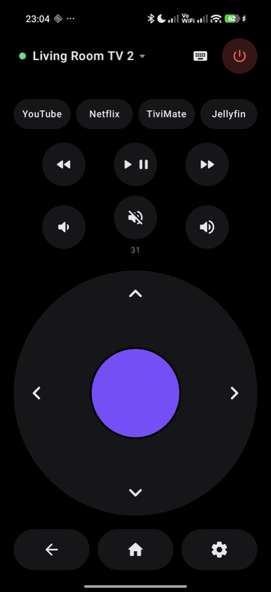
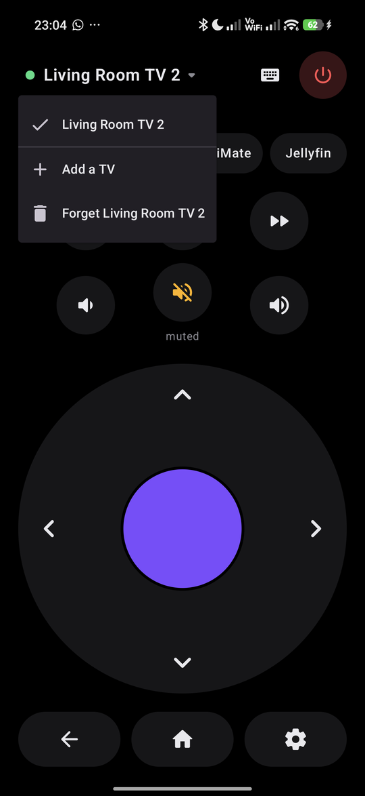
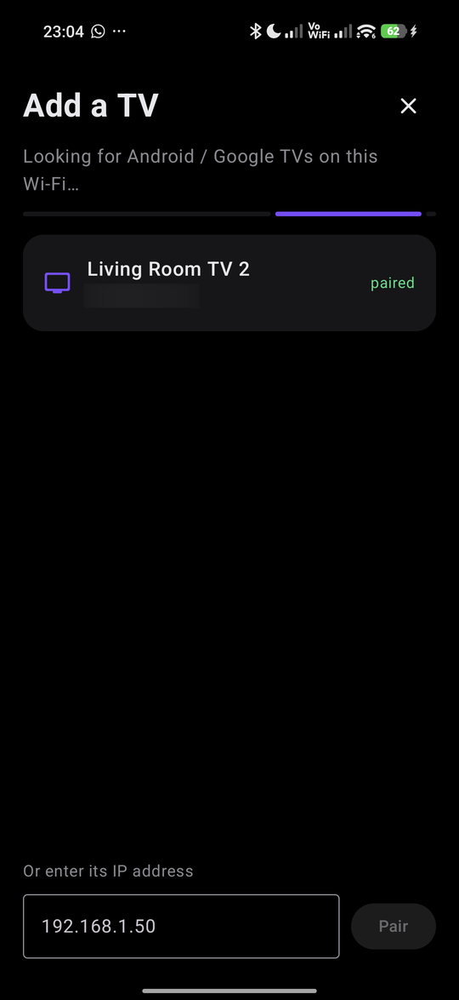
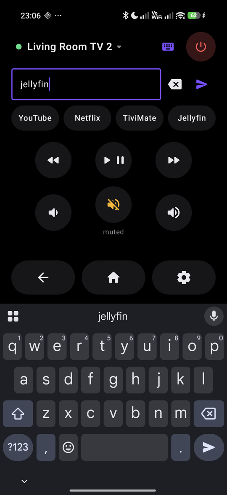

# TV Remote (Android)

The phone version of [qt-android-remote](https://github.com/dmarkey/qt-android-remote): a simple, quick
Android TV / Google TV remote. It's built for one phone, the **Poco F9 Ultra**.
It talks directly to the TV over the Android TV Remote v2 protocol (ports 6466/6467),
the same protocol `androidtvremote2` uses.

<p align="center">
  
  
  
  
</p>
<p align="center"><sub>Remote · TV picker · Add a TV (mDNS discovery) · Typing to the TV</sub></p>

## Speed and simplicity

- **Opens straight to the remote.** It connects to the last TV used as soon as the app is visible.
  The connection stays open for 60 s in the background, so switching apps doesn't reconnect.
- **The phone's volume rocker controls the TV** while the app is connected. Holding it repeats.
- **Buttons fire on touch-down**, not on release. The D-pad, volume and seek buttons repeat while held.
  Holding OK sends a long press, which opens context menus on Google TV.
- **Laid out for the 6.9" screen held in one hand:** the D-pad, Back and Home sit in the bottom
  half where your thumb is. Power, the TV picker and the keyboard are at the top.
- **Pairing in one step:** tap the discovered TV and type the 6 characters shown on it.
  The code submits by itself on the last character.
  The first character is a checksum, so typos are caught before anything is sent to the TV.
- If the TV forgets the phone (factory reset, cleared data), the app offers **Pair again**.
  It doesn't delete the TV from the list.

## Poco F9 Ultra specifics

- **185 Hz panel:** the app asks for the highest refresh mode, since HyperOS often holds apps at 60/120 Hz.
- **X-axis linear motor:** uses the predefined tick/click/heavy effects,
  so taps still vibrate when HyperOS's "touch feedback" setting is off.
- **AMOLED:** a true-black theme, including the launch window, so there's no white flash.
- Portrait only, edge-to-edge. minSdk 34 / targetSdk 35, release build optimized with R8 (about 2 MB).
- The client key is generated in the phone's **Android Keystore** and never leaves it.
  One identity is used for every TV.

## Build and install

```bash
./gradlew assembleRelease          # app/build/outputs/apk/release/app-release.apk
adb install -r app/build/outputs/apk/release/app-release.apk
./gradlew testReleaseUnitTest      # protobuf codec / framing tests
```

The release build is signed with the local debug key, because it's for sideloading only.
On HyperOS, `adb install` also needs **Developer options → Install via USB** turned on.
That toggle requires being signed in to a Mi account.

## Layout

| File | What it does |
|---|---|
| `Proto.kt` | A minimal protobuf writer and reader, plus varint length framing. No protobuf dependency |
| `Identity.kt` | Keystore RSA key and self-signed certificate, and the TLS socket factory |
| `Pairing.kt` | Polo pairing handshake on port 6467, and the code hash |
| `TvSession.kt` | Remote connection on port 6466: configure, answer pings, auto-reconnect, send keys, text and app links |
| `Discovery.kt` | mDNS discovery of `_androidtvremote2._tcp` |
| `RemoteViewModel.kt` | Screens, pairing flow, foreground/background connection |
| `ui/` | Compose UI: the D-pad, buttons that fire on touch-down, and the remote, setup and pairing screens |
